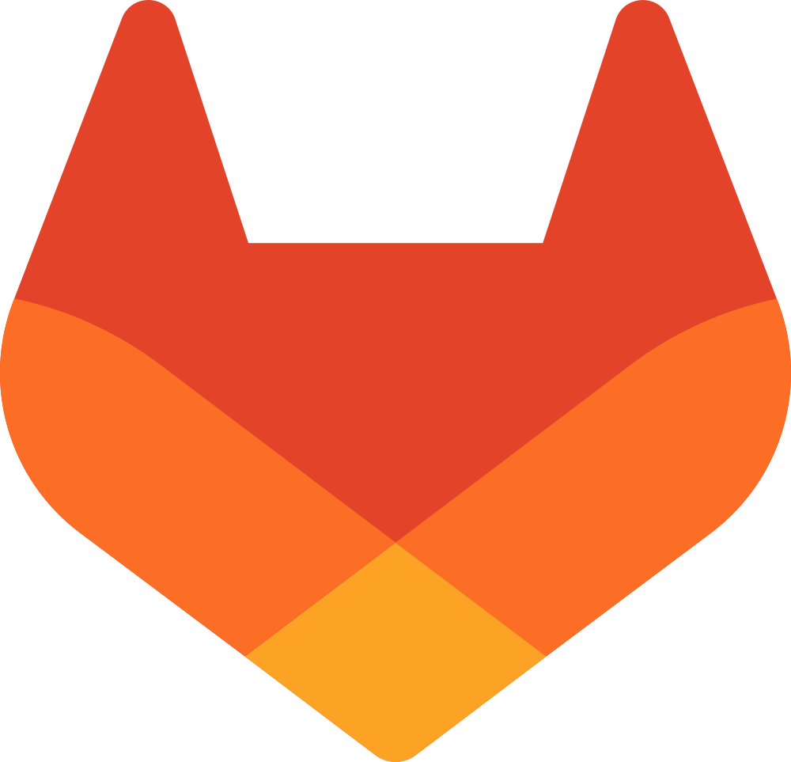
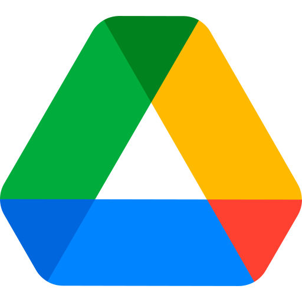
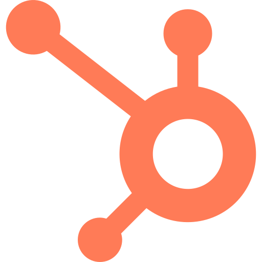
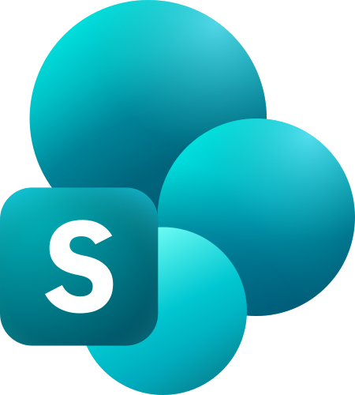

<pre align="center">
 ██████╗ ██████╗ ███╗   ██╗████████╗███████╗██╗  ██╗████████╗██████╗
██╔════╝██╔═══██╗████╗  ██║╚══██╔══╝██╔════╝╚██╗██╔╝╚══██╔══╝██╔══██╗
██║     ██║   ██║██╔██╗ ██║   ██║   █████╗   ╚███╔╝    ██║   ██║  ██║
██║     ██║   ██║██║╚██╗██║   ██║   ██╔══╝   ██╔██╗    ██║   ██║  ██║
╚██████╗╚██████╔╝██║ ╚████║   ██║   ███████╗██╔╝ ██╗   ██║   ██████╔╝
 ╚═════╝ ╚═════╝ ╚═╝  ╚═══╝   ╚═╝   ╚══════╝╚═╝  ╚═╝   ╚═╝   ╚═════╝
</pre>

<h1 align="center">ContextD</h1>

<p align="center">
  <strong>Enterprise context database infrastructure for AI agents.</strong>
</p>

<p align="center">
  <a href="https://github.com/ContextD/contextd-engine"></a>
  <a href="https://discord.gg/gDuebsWGkn"></a>
  
  
</p>

<p align="center">
  
  
  
  
  
  
  
</p>

ContextD is an enterprise context database and infrastructure layer for AI systems. It connects
to operational sources like Gmail, PostgreSQL, ClickHouse, Slack, and document stores, then
syncs them through durable workers, normalizes raw records into entities and relationships, and
stores the result across PostgreSQL metadata, Neo4j graph/fulltext, Milvus vector memory, Redis
cache/session state, and Temporal orchestration.

Instead of sending agents a pile of similar chunks, ContextD serves grounded context: people,
companies, database rows, messages, timelines, relationships, and source evidence assembled from
the graph. Use it as the shared memory plane behind assistants, RAG apps, data-360 workflows,
decision support, and internal agent systems that need current enterprise context.

## Quickstart

### Self-hosted

```bash
git clone https://github.com/ContextD/contextd-engine.git
cd contextd-engine
make start
```

→ http://localhost:8080

> Requires Docker and docker-compose

### Local Development

For development with hot reload you can either start everything in one go or run each part separately.

Common commands:

| Command | What it does |
| --- | --- |
| `make start` | Start the Docker dev stack without deleting local data |
| `make start-build` | Rebuild Docker images, then start |
| `make reset` | Remove ContextD containers/Postgres volume, then start fresh |
| `make local-dev` | Run infra in Docker and app processes on the host |
| `make validate` | Run backend lint/tests and frontend lint/build |

#### Option A: One-command startup (recommended)

From the repository root, start Docker infrastructure plus backend, frontend, and the Temporal worker locally (all in one script; press Ctrl+C to stop the local processes):

```bash
make local-dev
```

This starts Postgres, Redis, Milvus, Temporal, Temporal UI, and Neo4j in Docker, then runs backend, frontend, and worker on the host. The worker is required for sync jobs; without it, syncs will not run.

#### Option B: Run each part separately

**1. Start infrastructure with Docker:**

```bash
# From repo root
make infra
```

**2. Run Backend (Hot Reload)**

```bash
make backend
```

→ Backend API: http://localhost:8001

**3. Run Frontend (Hot Reload)**

```bash
make frontend
```

→ Frontend UI: http://localhost:8080

**4. Run Worker (Temporal)**

The worker processes sync jobs. It does not start automatically; run it in a separate terminal (or use `make local-dev` to start it with backend and frontend):

```bash
make worker
```

#### Environment Setup

`make start` automatically creates a `.env` file from `.env.example`. For local development, you may need to add:

```bash
# Required for file processing and search
OPENAI_API_KEY="your-api-key"

# Optional
MISTRAL_API_KEY="your-api-key"
```

For OAuth integrations, configure your own application credentials in
`backend/contextd/platform/auth/yaml/dev.integrations.yaml` when using the `local` or
`dev` environment, or in `self-hosted.integrations.yaml` for self-hosted mode. The
committed configuration uses placeholders; keep real credentials out of Git commits.

## Supported Integrations

<!-- START_APP_GRID -->

<p align="center">












</p>

<!-- END_APP_GRID -->

## Docker Build

Build and run the backend and frontend Docker images individually:

#### Build Backend

```bash
cd backend
docker build -f ../docker/backend/Dockerfile -t contextd-backend ..
docker run -p 8001:8001 --env-file ../.env contextd-backend
```

#### Build Frontend

```bash
cd frontend
docker build -f ../docker/frontend/Dockerfile -t contextd-frontend ..
docker run -p 8080:8080 contextd-frontend
```

> Note: The backend requires infrastructure services (PostgreSQL, Redis, Milvus, Neo4j, and Temporal) to be running. Use `docker compose -f docker/docker-compose.yml up -d` to start all services together.

## Tech Stack

- **Frontend**: [React/TypeScript](https://react.dev/) with [ShadCN](https://ui.shadcn.com/)
- **Backend**: [FastAPI](https://fastapi.tiangolo.com/) (Python)
- **Databases**: [PostgreSQL](https://www.postgresql.org/) (metadata), [Neo4j](https://neo4j.com/) (graph and fulltext search), [Milvus](https://milvus.io/) (ADK memory vectors)
- **Workers**: [Temporal](https://temporal.io/) (orchestration), [Redis](https://redis.io/) (pub/sub)
- **Deployment**: [Docker Compose](https://docs.docker.com/compose/)

<p align="center">
  <a href="https://discord.gg/gDuebsWGkn">Discord</a> ·
  <a href="https://github.com/ContextD/contextd-engine/issues">Issues</a>
</p>
